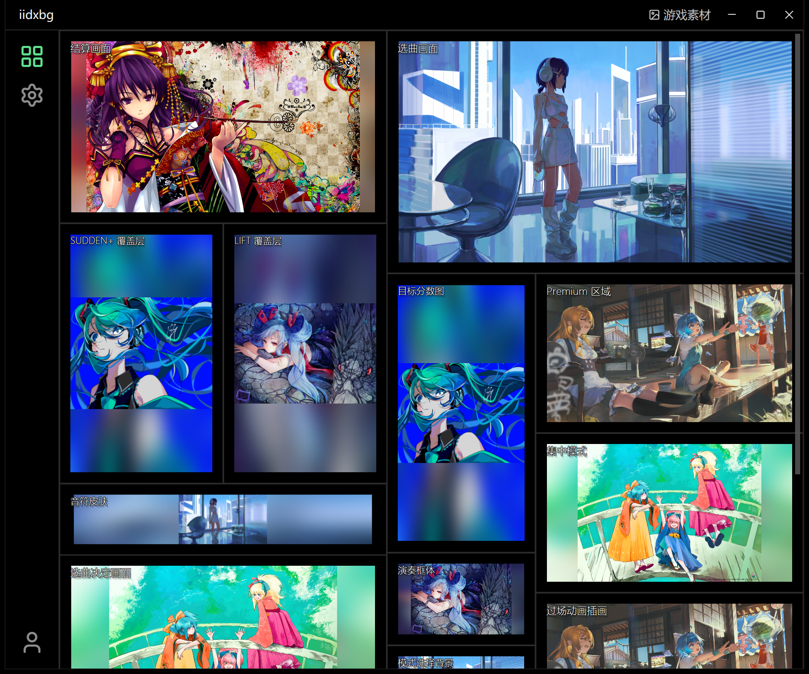
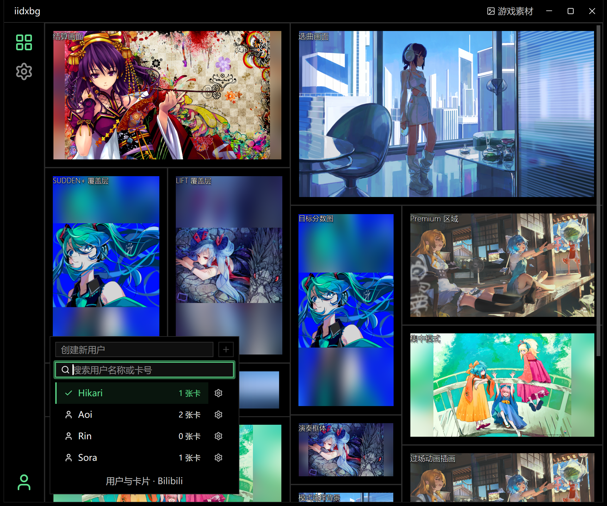
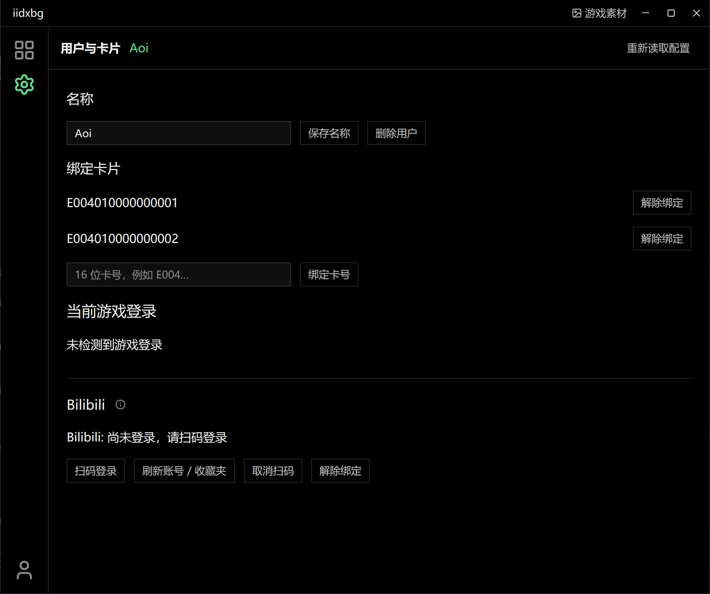
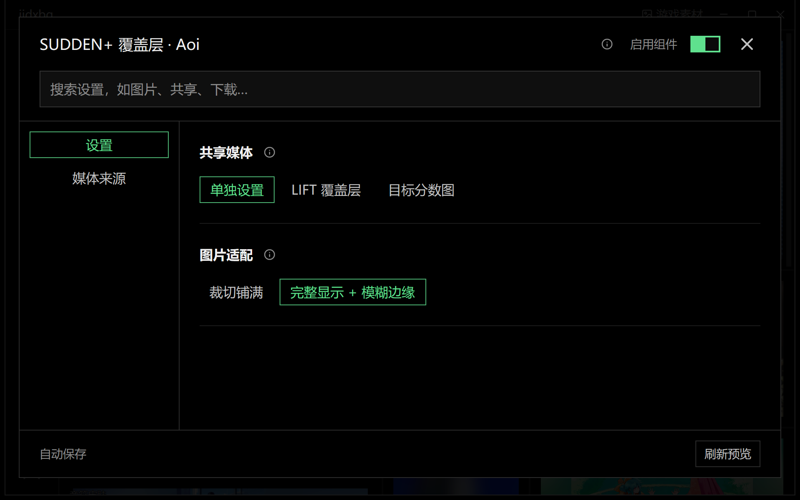
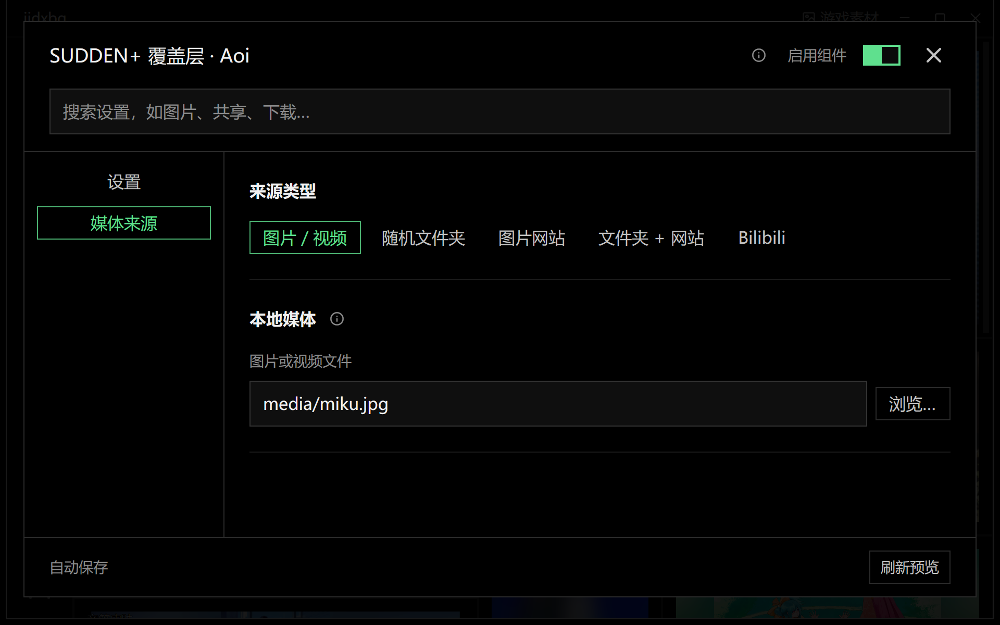
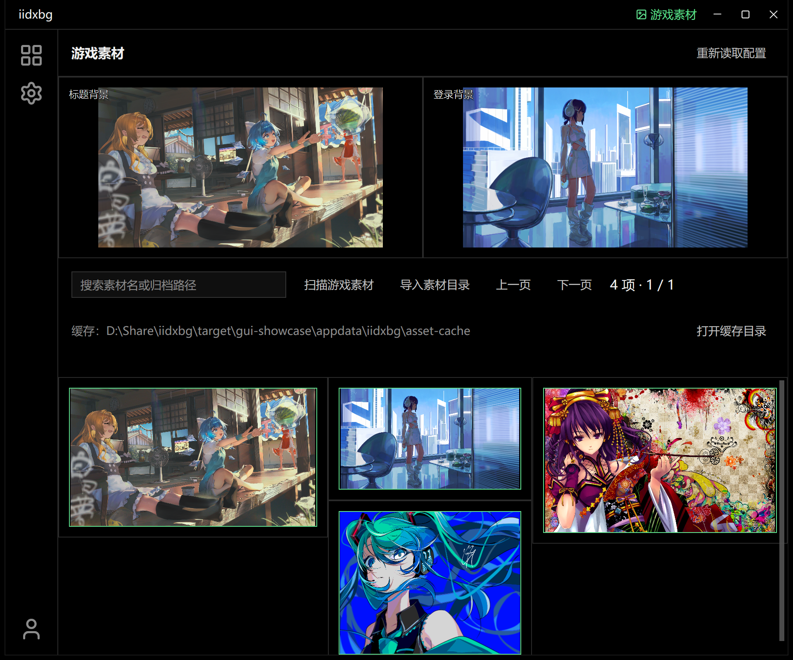

# iidxbg

给 **beatmania IIDX (spice2x)** 用的背景替换插件。

把游戏里的结算插画换成你喜欢的图片或视频；也可以进一步替换选曲画面、SUDDEN+、LIFT、目标分数图和 Premium/集中模式背景。媒体可以来自固定文件、随机文件夹，图片也可以从 Moebooru 兼容 API 获取。

<a href="docs/config-gui.png"></a>

*显示组件：预览各模块，点击画面进入设置。*

## 这是什么

- 替换 IIDX 的 **结算画面插画**，由用户单独开启
- 可选替换 **选曲画面、SUDDEN+、LIFT、目标分数图** 等位置
- 支持固定图片/视频、文件夹随机、Moebooru 兼容 API，以及本地/在线混合
- 结算、选曲、SUDDEN+、LIFT、目标分数图支持静音循环视频；在对应组件中选择「固定图片 / 视频」
- 左下角用户菜单支持搜索与一键切换；「用户与卡片」支持一个用户绑定多张卡；未绑定的卡与游客不替换用户模块
- 顶栏「游戏素材」置顶显示共用的标题与登录画面设置；其他组件、角色与 Qpro 按用户保存
- Bilibili 来源支持固定视频、随机推荐、合集/系列、收藏夹；在「用户与卡片」中扫码登录
- SUDDEN+ 可绑定 LIFT，共享选中的媒体、解码器和纹理；绑定目标关闭时仍可作为来源
- 附带 **iidxbg-config.exe** 配置界面，不需要手动编辑配置文件
- 选曲角色可导入 PMX + VMD 实时动画，并分别配置平时、滚动和成绩反应动作；仅限已验证的 010-0917 构建，详见 [MMD 说明](docs/mmd-character.md)
- 每次有效修改立即保存，没有“保存”按钮

## 配置界面

点击截图可查看原图。

| 用户切换 | 用户与卡片 |
|---|---|
| [](docs/config-users.png) | [](docs/config-account.png) |
| 搜索名称或卡号，当前用户以绿色置顶。 | 多张卡共用用户设置，Bilibili 账号按用户绑定。 |

| 模块设置 | 媒体来源 |
|---|---|
| [](docs/config-settings.png) | [](docs/config-media.png) |
| 选择共享媒体与图片适配方式，修改自动保存。 | 选择本地或在线来源；仅在「单独设置」时显示。 |

<a href="docs/config-assets.png"></a>

*游戏素材：标题、登录背景与直接素材替换对所有用户及游客共用。*

截图使用演示用户、卡号、本地图片与素材目录；安装包不包含示例图片。

## 怎么用

1. 从 [GitHub Releases](https://github.com/Avimitin/iidxbg/releases) 下载最新 ZIP。
   ZIP 里只有三个文件：
   - `iidxbg.dll`
   - `iidxbg.toml`
   - `iidxbg-config.exe`

2. 把这三个文件解压到 **spice2x 游戏目录**。

3. 双击 `iidxbg-config.exe`：
   - 点击左下角用户图标，在菜单顶部输入名称并点击加号创建用户；
   - 在「显示组件」开启当前用户需要的组件；新用户的所有模块默认关闭，组件名称始终可见；
   - 给想替换的组件选择固定图片/视频，或随机文件夹；
   - 或者把图源切换为 Moebooru API，选择内置站点或填写兼容接口；
   - 修改会自动保存到旁边的 `iidxbg.toml`。

4. 在 spice64 的启动参数里加上：

   ```text
   -k "你的游戏目录\iidxbg.dll"
   ```

   保留你原有的其他启动参数。

5. 在游戏中刷卡登录，再切换到配置窗口。在左下角菜单选择用户，进入「用户与卡片」，将「当前游戏登录」显示的卡号绑定给该用户，也可手动输入卡号。一个用户可以绑定多张卡，共用同一套设置。

未绑定的卡、游客、未开启的组件或没有可用媒体时使用游戏原图。配置程序不必在刷卡时保持打开。用法、配置结构与登录识别的验证范围见 [用户与登录会话](docs/user-sessions.md)。

> ZIP 不包含示例图片。第一次打开配置程序时，本地预览为空是正常的；选好文件夹或在线图源后就会出现图片。

## 支持哪些版本

| 游戏版本 | 状态 |
|---|---|
| IIDX 33 / 010-20260819 | 已实机确认 |
| IIDX 34 / 20260917 | 离线验证 |
| IIDX 34 / 010-0917 | 已实机确认 FAILED/F 结算、选曲、目标分数图、SUDDEN+、LIFT 视频；覆盖范围见验证记录 |

要求：

- Windows x64
- spice2x，且支持 **Spice SDK v0.4 D3D9 callbacks**
- 只支持上表中的 x64 版本；其他版本不会加载

补充说明：

- **结算画面**：三个支持版本都可用。
- **选曲画面、SUDDEN+、LIFT、目标分数图**：需要单独开启，仍在继续测试。
- **Premium 区域 / 集中模式**：仅支持 IIDX 34 / 010-0917。
- 各构建、模式的验证范围见 [验证记录](docs/validation.md)。实际显示可能受游戏裁剪或遮罩影响。

结算视频推荐 H.264 MP4，其他格式取决于游戏机器安装的 Windows 解码器。
文件路径可绝对指定，也可相对于 `iidxbg.toml`；修改在后续结算生效。
解码失败时使用图片来源。当前只替换单曲结算背景，不替换游玩中的 BGA。
分辨率和已知限制见 [视频说明](docs/video-surfaces.md)。

## 下载

最新版本：[GitHub Releases](https://github.com/Avimitin/iidxbg/releases)

当前版本：**0.6.0**。支持多用户切换、多卡绑定与按用户绑定 Bilibili 账号；
顶栏「游戏素材」集中管理所有用户共用的替换内容。

## Bilibili 来源

在**运行游戏的机器**上打开配置程序，选择用户，进入「用户与卡片」扫码绑定 Bilibili 账号。
每个用户独立绑定；切换用户会切换对应账号、收藏夹和媒体来源使用的登录状态。
Cookie 用 Windows DPAPI 加密，按配置文件与用户分别保存在
`%LOCALAPPDATA%\iidxbg\bilibili-users\`，不会写进 TOML。
配置程序和游戏须使用同一台机器、同一个 Windows 用户；登录失效或移动配置文件后重新扫码。
「解除绑定」只删除当前用户的凭据。旧版共享登录不会自动继承，请为每个用户重新绑定。
登录前的共享画面不使用任何用户账号。视频缓存也按用户分开，解除绑定时保留。

返回「显示组件」，将需要的组件来源设为 Bilibili：

| 模式 | 输入与行为 |
|---|---|
| 固定视频 | 完整 `https://www.bilibili.com/video/BV…` 链接、BV 号或 av 号；支持链接中的 `p=2` 分 P |
| 随机推荐 | 使用已登录账号的网页推荐流；随机选一个可播放的视频 |
| 合集 / 系列 | UP 主空间的合集/系列链接，例如 `https://space.bilibili.com/123/lists/456?type=season`；随机选视频 |
| 收藏夹 | 收藏夹链接（含 `fid`）或文件夹 ID，也可直接选择账号页加载的收藏夹；随机选视频 |
| 直播间 | `https://live.bilibili.com/24065` 或数字房间 ID；每个组件可独立选择 |

收藏夹内容可在手机 App 中维护，插件在下一次准备时重新读取。短链接 `b23.tv` 暂不支持，
请使用展开后的完整链接。不可访问、删除、超出时长或没有 H.264 版本的视频会跳过；准备失败
保留先前媒体，首次尚无媒体则使用游戏原图。推荐结果可能与手机客户端不同。

点播视频会先完整缓存，再交给现有 Windows Media Foundation 解码器；不是边下载边播放。
播放静音循环，不发送观看进度、点赞或收藏操作。每次结算固定一个视频；SUDDEN+/LIFT/目标图
仍可绑定并共享解码器及纹理。Premium/集中模式也支持视频和直播。

可选 TOML 设置（省略时使用这些默认值）：

```toml
[bilibili]
cache_directory = 'iidxbg/bilibili-cache'
quality = 64                 # 16=360p, 32=480p, 64=720p, 80=1080p，上限受账号权限影响
max_download_mb = 128
cache_mb = 2048
max_duration_seconds = 600

# 示例：给结算选择收藏夹；编辑已有 section，不要重复添加。
[sources.results]
source = "bilibili"
[sources.results.bilibili]
mode = "favourites"          # video / recommendations / playlist / favourites / live
favourites = "123456"
```

缓存只清理插件自己命名的文件；正在使用的视频被保留。Bilibili 的客户端接口可能变化，
风控或网络错误会显示在预览中。无需捆绑 FFmpeg。

## License

MIT

直播使用 Bilibili H.264 fMP4/HLS 流，静音播放，不需要 FFmpeg。每个组件可设置
`mode = "live"` 和 `room = "24065"`，也可绑定兼容组件以共享网络、解码和纹理。
直播不写入点播缓存：只在 Windows 临时目录保留短分片，读完即删；通常有数秒延迟。
每路最多四份 16 MiB 分片（解码中、队列两份、准备中一份），另有初始化数据和三帧像素队列。
隐藏的组件在最后一个播放租约释放后停止取流，再次显示从直播当前进度开始。
断网时保留最后一帧并重试；首次未开播或没有兼容流时保留原背景。
`[bilibili]` 的下载大小、时长和缓存额度用于点播，不控制直播短缓冲。
