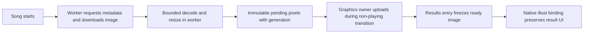

> Archived feasibility investigation before implementation. For the current implementation and validation status, see [iidx34-analysis.md](iidx34-analysis.md). Historical commands below refer to the original research checkout; use `python scripts/verify-native.py path/to/bm2dx.dll` here.

# IIDX 34 / 20260917 dynamic results-background feasibility

Analysis date: 2026-10-20. “Score page” is interpreted as the **per-song results
screen**, not music selection, gameplay BGA, or a course's overall results.

Target: `C:\Users\BeatMania IIDX LM\Downloads\bm2dx.dll`.
SHA-256: `3755587f44785effe5008f74cfe7dccbdf423ad09feead48e00a90f78a42fe83`.
Size: 18,200,216 bytes. Preferred image base: `0x180000000`.
All native addresses below are **RVAs**; object offsets are decimal.
The repository's 20260917 label is user supplied; upstream sp2xpatcher identifies
this PE as `LDJ-6aa23d57_b02b3c`, dated 2026-09-16 (010).

## Conclusion and scope

**Feasible, with concrete native support for replacing the illustration texture.**
The results scene has a dedicated background component, an `illust` movie clip,
and a named `result_bg` texture binding. The same DLL also implements a second
movie-clip setter accepting a dynamic texture descriptor. Existing game code
uses that setter with `AfpTextureEx`, which can wrap a Direct3D texture.

Downloading the next image during play and selecting it for the next results
visit is a practical design. It does not require rewriting the DLL file or
overwriting stock image archives on every song. Network availability cannot
guarantee a fresh image for every visit: keep the previous ready image or stock
background when preparation misses the deadline.

This is static feasibility analysis, **not an implemented or game-tested hook**.
It establishes the illustration replacement path, not that `illust` covers every
pixel of the screen. Native masks, animation geometry, clear/failed variants and
special results screens still require asset inspection or live observation.

## Native evidence

| RVA | Verified role |
|---|---|
| `0xd72950` | RTTI `CStageResultScene`; slots 16/17/18 point to `0x914080` / `0x915580` / `0x915b10`; slot 27 to `0x915a10` |
| `0x911e60` | Results constructor; call at `0x911ed5` constructs background at `scene +264` |
| `0xd70598` | RTTI `StageResultDrawBg`; slots 0/1/2: `0x906d30` / `0x906d60` / `0x906e70` |
| `0x913270` | Component index 0 returns `scene +264`; constructor stores it at `scene +16088` |
| `0x917860` | Setup state includes 14-component loop at `0x9179a0`, dispatching slot 1 |
| `0x915a10` | Scene callback loops over 14 components from `scene +16088`, dispatching slot 2 with a timing argument |
| `0x906b40` | Background constructor chooses an archive and stores its resource pointer at `background +272` |
| `0x620ad0` | `StageResultFileNameMaker` path; fallback stem `result_get_clear`, optional numbered suffix, `.ifs` extension |
| `0x818ee0` | Resolves under `/data/graphic/`, checks existence, calls resource manager |
| `0x906d60` | Creates header, background and difficulty movie clips; pointers at +288/+296/+304 |
| `0x907490` | Chooses `header_fullcombo`, `header_clear`, or `header_failed` |
| `0x907370` | Chooses `bg1_clear` or `bg1_failed` |
| `0x9074e0` | Chooses `diff_sp` or `diff_2pp` |
| `0x906e70` | Updates background-related UI; finds `illust` inside the clip at +296 |
| `0x81e9f0` | Null-checked named clip lookup, delegates to `0x32d1a0` |
| `0x329f30` | Archive/name texture setter; obtains descriptor through `afp_utils_71` / `_77`, binds through `afp_core_137` |
| `0x329e50` | Dynamic-descriptor setter; uses the same `afp_core_137` import, without archive-name lookup |
| `0xa4f8a0` | `AfpTextureEx` constructor wrapping an existing Direct3D texture; AddRef, registry registration and descriptor construction |
| `0x344b60` / `0x344ea0` | Registers Direct3D texture / constructs 40-byte descriptor using its dimensions |
| `0xa4fd40` | Returns `AfpTextureEx +24`, the descriptor |
| `0xa4fa30` | Destructor unregisters handle via `0x344c30` and releases texture |
| `0x63d9e0` | Existing native example: gets descriptor via `0xa4fd40`, binds to assistant character clip via `0x329e50` |

Relevant results branch, reconstructed from instructions:

```text
clip = find_clip(background.movie_at_296, "illust")  // call 0x906fd4
if clip:
    if background.archive_at_272:
        set_archive_texture(clip, archive, "result_bg") // call 0x906ff7
        set_origin(clip, 3, 3)                         // call 0x907007
    else:
        set_visible(clip, false)                       // call 0x90700e
```

`0x906e70` also updates `stage`, Premium Free timer elements, music title,
artist and difficulty. **Do not skip this entire callback to replace a picture.**
Call the original and then change only the intended illustration, or intercept
only its narrowly identified texture operation. A global `result_bg` name hook
would need extra scene/clip checks because names can be reused elsewhere.

The dynamic descriptor at `AfpTextureEx +24` is 40 bytes:
handle at +0, dimensions at +4/+8, coordinate fields following, auxiliary pointer
at +32. The wrapper has its texture pointer at +8 and registered handle at +16.
Do not pass a raw `IDirect3DTexture9*` to `0x329e50`: it expects the descriptor.
Do not pass an `AfpTextureEx*` to the archive setter: that setter expects a
different object with its archive handle at +1300.

ABI evidence is Microsoft x64, with `this` in RCX and the descriptor in RDX for
`0x329e50`. Its result is byte success in AL. The slot-2 dispatcher supplies a
second timing argument in EDX even though the background implementation does
not consume it; a future hook must preserve the actual callback signature.
Decompiler types are inferred, not headers. In particular, verify float/stack
arguments when using `0x344ea0`; prefer the existing wrapper/getter path.

The setter enables an AFP property and binds texture data; it does not establish
the final full-screen rectangle. The original origin helper `0x32a460` consults
stored archive metadata. A custom image therefore needs deliberately verified
dimensions/origin/UVs, not an assumption that arbitrary image sizes fit.

## Proposed hook and image lifecycle

### Newly downloaded images versus replacing bundled files

The user's follow-up specifically asks whether a running game can consume a
**new image and an updated path**, beyond replacing a bundled resource before
startup. These are two different mechanisms:

| Mechanism | Evidence and status |
|---|---|
| Overwrite the existing `.ifs` or change a pathname variable | Does not itself establish a reload; the live movie clip already holds a resource/texture binding |
| Load a different archive path and rebind | Plausible, but requires a valid AFP/IFS resource, correct mounting, cache/lifetime handling and rebinding; arbitrary JPG paths are not proven inputs to this archive loader |
| Decode new image bytes, create a texture, register it, and rebind `illust` | Directly supported by the native wrapper/descriptor functions traced above; preferred prototype, with live validation still pending |

The archive-cache behavior is concrete: manager `0x33c450` first calls
`0x33d840`, which looks up the filename and resource option among cached entries.
On a hit it calls `0x33af10` on the existing entry. That function reads and
mounts archive bytes only when the reference count at entry +1292 is <=0.
Otherwise it increments the count and returns without reading the file again.
Consequently, overwriting an archive at the same path while it remains
referenced does **not** refresh it through this load path. A new path can avoid
that cache hit but does not automatically update clips already bound to the old
resource, nor turn a JPG into an AFP package.

The proposed dynamic path explicitly performs the missing operations:

```text
URL A -> downloaded JPEG/PNG bytes -> decoded pixels -> new D3D texture A
      -> AfpTextureEx(texture A) -> descriptor A -> bind existing illust

URL B -> downloaded JPEG/PNG bytes -> decoded pixels -> new D3D texture B
      -> AfpTextureEx(texture B) -> descriptor B -> bind on next results visit
```

The plugin owns HTTP and image decoding; the stock DLL is not asked to
understand a URL. A disk filename is optional. If configuration instead supplies
a changing local image path, the plugin can read that file on its worker and
use the same decode/create/rebind pipeline. Path changes become new preparation
jobs with generations, not writes into a live game string.

Thus the evidence goes beyond a static asset replacement: `0xa4f8a0` accepts
an actual texture pointer, `0xa4fd40` supplies its descriptor, and `0x329e50`
binds that descriptor without looking up a bundled image name. The existing
`0x63d9e0` caller demonstrates this descriptor-to-clip connection in native code.
What is not yet proved is a complete custom downloader-to-results implementation
running successfully inside this game.

### Hook placement

Preferred proof of concept: an optional, fingerprint-guarded IIDX feature using
the native illustration clip and dynamic descriptor binding.

1. Preserve the normal background callback. After it, look up this instance's
   `illust`, and bind the frozen custom descriptor if one is ready. Handle the
   stock no-archive branch, which hides the clip; explicitly restore visibility
   only when the custom resource is valid.
2. Keep native score, graph, title, timer and other foreground elements intact.
   Reapply at the native callback if necessary because the original can restore
   its archive texture. Do not allocate/upload a texture every callback.
3. Use result scene lifecycle plus a monotonically increasing generation to
   select an image once per visit and retire it only after the clip no longer
   references it. Establish callback ordering and thread identity in the live
   proof of concept before retaining native pointers.
4. Guard exact build, vtables and native entry bytes, and preserve accepted hook
   chains. Failure disables the cosmetic feature and retains stock behavior.

An end-of-frame fullscreen image in the existing Spice SDK menu overlay would
cover foreground UI; that alone does not implement background replacement.
Using the native clip also lets the game's renderer retain its layering and
animations, subject to visual verification. If the requested area extends
beyond `illust`, trace the surrounding AFP background shapes separately.

Proposed asynchronous flow:



Keep separate pending CPU pixels, ready GPU resource and active-results
reference. A completed transfer is not yet a render-ready texture. With a
fixed viewport, 1920x1080 BGRA is 8,294,400 bytes per CPU image, before GPU and
decoder allocations; bound the number of pending images.

Fetch once per chosen song/rotation, using one background job with bounded
memory, download size, decoded pixel count, timeouts and retry backoff.
Decode and resize off the game thread; publish an owned immutable buffer.
No HTTP, disk write, decoding, waiting for worker completion or unbounded locks
inside input, scene or render callbacks. Keep network and CPU job load modest;
a worker thread does not prove zero gameplay impact.

For the conservative first implementation, defer GPU creation/upload until a
verified non-playing transition and freeze the selection before results first
draw. If not ready by that boundary, use an already prepared image or stock.
Late arrivals wait for the next visit; do not flash a new image halfway through
the current result. If transition upload proves too expensive, preallocate or
stage a bounded upload and measure it before enabling during play.

All Direct3D and native AFP registry operations belong to the verified graphics
owner, including cleanup. Microsoft documents Direct3D 9's thread constraints
and reset/resource requirements:
[multithreading](https://learn.microsoft.com/en-us/windows/win32/direct3d9/multithreading-issues),
[lost devices](https://learn.microsoft.com/en-us/windows/win32/direct3d9/lost-devices).
Respect the actual D3D9/9Ex device and reset path; retain CPU pixels if recreation
is needed, release owned default-pool resources as required, and invalidate
stale handles. Do not have a download thread call the native wrapper constructor.

If implemented here, build-specific hooks stay in the IIDX game crate/DLL.
This is separate from request-queue scheduling; no game pointers in HTTP
handlers, no provider controls added to the in-game queue menu, and no change
to queue payloads or OBS selection ownership. Existing public `phase: other`
is not a sufficient result-screen detector; an internal native lifecycle is
needed. This analysis does not change the runtime architecture or API.

## Konachan integration evidence

The [official API](https://konachan.net/help/api) supports JSON post listing
with `limit`, `page` and `tags`. It documents a maximum of 100 posts per listing
and throttling status 421. No fixed requests-per-second allowance is assumed.

A read-only request on 2026-10-20 succeeded without authentication:

```text
GET https://konachan.net/post.json?limit=1&tags=rating%3Asafe
```

Observed post 409820 had rating `s`, width 6150, height 3948, original file size
19,574,292 bytes, and nonempty HTTPS `file_url`, `jpeg_url`, `sample_url`.
Its sample dimensions were 1500x963. Only metadata was requested in this
investigation; **image download and decoding were not tested**. The latest-post
response is mutable; use `tags=id%3A409820` for a targeted follow-up.

Use returned URLs rather than synthesizing paths. Select a sample/JPEG or
original according to validated dimensions and size; original resolution is
not automatically useful for a 1080p result screen. Validate the actual response
and decode result, including redirects and body/pixel limits. Empty lists,
timeouts, blocked image responses and throttling keep the existing background.
Use a configurable tag filter with an explicit `rating:safe` default; shuffle
eligible metadata locally if rotation is wanted. This design needs no account
credentials, upload or server-side mutation.

## Reproduce and remaining validation

Using the existing local analysis environment:

```powershell
analysis/iidx34-tools/Scripts/python.exe scripts/verify-iidx34-result-background.py 'C:\Users\BeatMania IIDX LM\Downloads\bm2dx.dll'
```

Dependencies: `pefile`, `capstone`. The script checks SHA-256, RTTI/vtable
targets, exact callsites/string references, archive/dynamic texture paths,
descriptor getter and destruction path. It never executes the DLL or contacts
the provider. It establishes anchors for review, not complete semantic or ABI
proof. IDA follow-up: decompile the table entries above, especially `0x906e70`,
`0x329f30`, `0x329e50`, `0xa4f8a0`, `0xa4fa30` and `0x63d9e0`.

Offline verification passed on the supplied file. No runtime source was changed;
Rust/TypeScript builds are not relevant to these documentation/research changes.
Before shipping a hook:

- First bind one local diagnostic image; inspect visible bounds, aspect ratio,
  mask, animation and foreground readability in TDJ.
- Validate clear, failed, full combo, SP both sides, DP/2P and Premium Free;
  Dan/Arena/StepUp/overall result classes are separate and not covered by this
  proof. Verify repeated visits and result exit/resource retirement.
- Confirm owner thread and callback ordering; validate native wrapper allocation,
  descriptor lifetime, reference counts, unload and device-reset handling.
- Then exercise network success, timeout, corrupt/oversized image, stale job,
  rapid scene changes and late completion. Every failure must preserve UI.
- Compare frame-time tails and input cadence with feature off/on during play.
  Include decode and texture upload separately. Do not claim stable 120 Hz or
  improved scoring merely because work uses a background thread.
